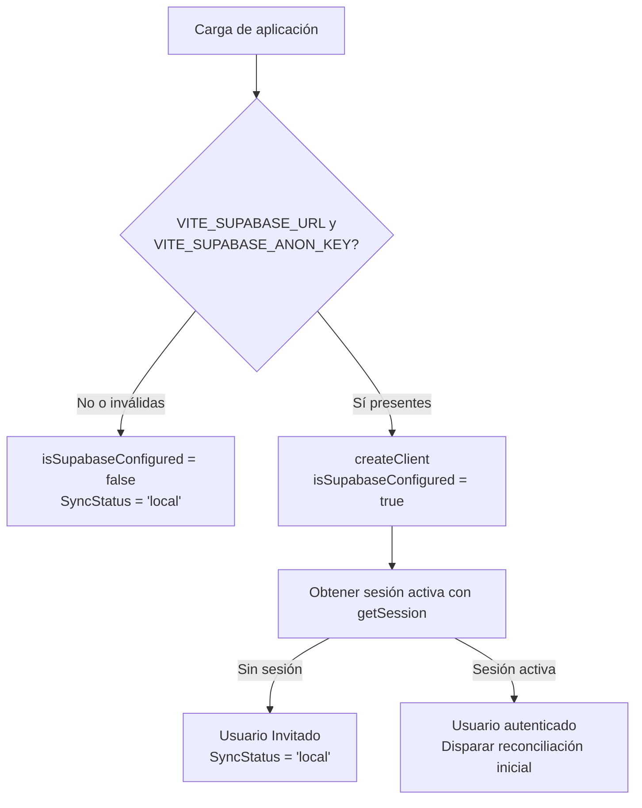

# Plan de Arquitectura Técnica — Spec 006
**Fase 4: Autenticación, Sincronización Cloud con Supabase y Backup Local**

---

## 1. Archivos y responsabilidades

```text
src/
├── interfaces/
│   └── sync.interface.ts                      # [Nuevo] Contratos de base de datos Supabase, estado de sync y backup JSON
├── lib/
│   └── supabase.ts                            # [Nuevo] Instanciación segura del cliente Supabase con detección defensiva
├── features/
│   └── sync/
│       ├── core/
│       │   ├── mappers.ts                     # [Nuevo] Transformaciones puras snake_case (DB) <-> camelCase (Dominio)
│       │   ├── mappers.test.ts                # [Nuevo] Tests unitarios de mapeo bidireccional
│       │   ├── reconciliation.ts              # [Nuevo] Algoritmos puros de conciliación LWW y fusión de gamificación
│       │   ├── reconciliation.test.ts         # [Nuevo] Tests unitarios de resolución de conflictos y fusiones
│       │   ├── backup.ts                      # [Nuevo] Generación y validación pura y defensiva de backups JSON
│       │   └── backup.test.ts                 # [Nuevo] Tests unitarios de serialización y validación de esquemas
│       ├── store/
│       │   ├── sync.store.ts                  # [Nuevo] Store Zustand para sesión (User), estado de sincronización y timestamps
│       │   └── sync.store.test.ts             # [Nuevo] Tests unitarios del store de sincronización
│       ├── hooks/
│       │   ├── useAuth.ts                     # [Nuevo] Hook para login, registro, logout y listener onAuthStateChange
│       │   └── useSyncEngine.ts               # [Nuevo] Orquestador de sincronización en background (mutaciones y window focus)
│       └── components/
│           ├── AuthDialog.tsx                 # [Nuevo] Diálogo accesible con pestañas Iniciar sesión / Crear cuenta
│           ├── AuthDialog.test.tsx            # [Nuevo] Tests de accesibilidad y validación del formulario
│           ├── AccountMenu.tsx                # [Nuevo] Menú desplegable en Header con indicador de sync y acciones
│           ├── AccountMenu.test.tsx           # [Nuevo] Tests del menú de cuenta e indicadores visuales
│           ├── ImportBackupDialog.tsx         # [Nuevo] Modal accesible para carga, previsualización y confirmación de backup
│           └── ImportBackupDialog.test.tsx    # [Nuevo] Tests de importación de archivos y manejo de errores
├── components/
│   └── custom/
│       └── Header.tsx                         # [Modificado] Integración de botón "Iniciar sesión" o <AccountMenu />
└── supabase/
    └── schema.sql                             # [Nuevo] DDL de tablas (collections, items, gamification_state), RLS e índices
```

---

## 2. Contratos y tipado estricto (`src/interfaces/sync.interface.ts`)

```typescript
import type { Collection } from './collection.interface';
import type { Item } from './item.interface';
import type {
  StreakInfo,
  UnlockedAchievement,
  XpEvent,
} from './gamification.interface';

export type SyncStatus = 'local' | 'syncing' | 'synced' | 'error';

// Filas de PostgreSQL (Supabase snake_case)
export interface CollectionRow {
  id: string;
  user_id: string;
  name: string;
  description: string | null;
  icon: string;
  accent_color: string;
  provider: string;
  statuses: unknown[]; // JSONB con CollectionStatus[]
  created_at: string;
  updated_at: string;
}

export interface ItemRow {
  id: string;
  user_id: string;
  collection_id: string;
  title: string;
  subtitle: string | null;
  release_year: number | null;
  cover_url: string | null;
  status_id: string;
  rating: number | null;
  notes: string | null;
  meta: Record<string, unknown>;
  xp_awarded: boolean;
  review_xp_awarded: boolean;
  created_at: string;
  updated_at: string;
}

export interface GamificationStateRow {
  user_id: string;
  total_xp: number;
  streak: StreakInfo;
  unlocked_achievements: UnlockedAchievement[];
  claimed_challenge_ids: string[];
  rewarded_collection_ids: string[];
  xp_history: XpEvent[];
  updated_at: string;
}

// Datos de gamificación desacoplados para sincronización y backup
export interface PersistedGamificationData {
  totalXp: number;
  streak: StreakInfo;
  unlockedAchievements: UnlockedAchievement[];
  claimedChallengeIds: string[];
  rewardedCollectionIds: string[];
  xpHistory: XpEvent[];
}

// Estructura oficial versionada de Backup JSON
export interface HoardexBackup {
  version: 1;
  exportedAt: string;
  collections: Collection[];
  items: Item[];
  gamification: PersistedGamificationData;
}
```

---

## 3. Funciones puras de lógica (`core/`)

### 3.1 Mappers (`src/features/sync/core/mappers.ts`)
- `mapCollectionRowToCollection(row: CollectionRow): Collection`: Mapea campos `snake_case` a `camelCase` asegurando tipos estrictos.
- `mapCollectionToRow(collection: Collection, userId: string, now: string): CollectionRow`: Transforma entidad de dominio a fila de PostgreSQL con `updated_at`.
- `mapItemRowToItem(row: ItemRow): Item`: Mapea campos y normaliza `meta`.
- `mapItemToRow(item: Item, userId: string, now: string): ItemRow`: Prepara fila de ítem para Supabase.
- `mapGamificationRowToState(row: GamificationStateRow): PersistedGamificationData`: Extrae el payload de gamificación.
- `mapGamificationStateToRow(data: PersistedGamificationData, userId: string, now: string): GamificationStateRow`: Serializa estado de gamificación a fila de BD.

### 3.2 Conciliación y resolución de conflictos (`src/features/sync/core/reconciliation.ts`)
- `reconcileEntitiesLWW<T extends { id: string; updatedAt?: string; createdAt?: string }>(local: T[], remote: T[]): T[]`:
  - Recorre la unión de claves `id`.
  - Si un registro existe solo en un extremo, se conserva.
  - Si existe en ambos, compara `new Date(remote.updatedAt).getTime()` contra `new Date(local.updatedAt).getTime()`. Prevalece la versión con fecha ISO más reciente (*Last-Write-Wins*).
- `reconcileGamification(local: PersistedGamificationData, remote: PersistedGamificationData): PersistedGamificationData`:
  - `totalXp`: `Math.max(local.totalXp, remote.totalXp)`.
  - `streak`: Selecciona la racha con `lastActivityDate` más reciente; si coinciden, la de mayor `currentStreak` o `longestStreak`.
  - `unlockedAchievements`: Unión por `achievementId`, conservando el `unlockedAt` más antiguo (primer desbloqueo).
  - `claimedChallengeIds`: `Array.from(new Set([...local.claimedChallengeIds, ...remote.claimedChallengeIds]))`.
  - `rewardedCollectionIds`: `Array.from(new Set([...local.rewardedCollectionIds, ...remote.rewardedCollectionIds]))`.
  - `xpHistory`: Unión deduplicada por `id`, ordenada cronológicamente descendente y recortada a los 50 eventos más recientes.

### 3.3 Backup y validación estructural (`src/features/sync/core/backup.ts`)
- `generateBackup(collections: Collection[], items: Item[], gamification: PersistedGamificationData, exportedAt: string): HoardexBackup`:
  - Ensambla el objeto con `version: 1` y los datos actuales.
- `validateBackup(data: unknown): { isValid: true; backup: HoardexBackup } | { isValid: false; error: string }`:
  - Validador puro en TypeScript: verifica que `data` sea objeto, `version === 1`, `collections` e `items` sean arrays bien formados con campos obligatorios (`id`, `name`, `title`, `collectionId`) y `gamification` contenga enteros válidos y arrays requeridos. Devuelve error tipado explicativo si falla.

---

## 4. Algoritmo y flujo de datos

### 4.1 Inicialización y modo Local-First (`supabase.ts`)


### 4.2 Conciliación bidireccional automática en login (`useSyncEngine.ts`)
1. Al autenticarse el usuario (`SIGNED_IN`), se activa el estado `syncStatus = 'syncing'`.
2. Se descargan en paralelo las filas del usuario en Supabase: `collections`, `items` y `gamification_state`.
3. Se transforman a entidades de dominio con `mappers.ts`.
4. Se ejecutan las funciones puras `reconcileEntitiesLWW` (para colecciones e ítems) y `reconcileGamification`.
5. Se actualizan los stores locales (`collections.store`, `items.store`, `gamification.store`) con los datos consolidados.
6. Se suben a Supabase las filas resultantes mediante `upsert`.
7. Se actualiza el estado `syncStatus = 'synced'` y se guarda `lastSyncedAt`.

### 4.3 Sincronización continua de mutaciones
1. Un suscriptor escucha cambios en `collections.store`, `items.store` y `gamification.store`.
2. Si el usuario está autenticado, aplica un *debounce* de 1500 ms.
3. Transcurridos los 1500 ms sin nuevas mutaciones, sube los cambios pendientes a Supabase.
4. Si la petición falla (offline / error de red), pasa a `syncStatus = 'error'` de forma no intrusiva y reintenta en el próximo foco de ventana (`focus` / `online`).

---

## 5. Integración en la interfaz de usuario

1. **`Header.tsx`:**
   - Si `isSupabaseConfigured === false`: Muestra botón de exportar/importar backup local.
   - Si `isSupabaseConfigured === true` y usuario no autenticado: Muestra botón *"Iniciar sesión"*.
   - Si usuario autenticado: Muestra `<AccountMenu />` con el correo del usuario, avatar compacto con indicador visual del estado de sincronización (punto verde = sincronizado, azul animado = sincronizando, rojo = error).
2. **`AuthDialog.tsx`:**
   - Modal accesible (`role="dialog"`) con pestañas para *"Iniciar sesión"* y *"Crear cuenta"*.
   - Formulario con inputs para email y contraseña (mínimo 6 caracteres).
   - Manejo de estados de carga, deshabilitación de botones y emisión de toasts descriptivos con Sonner.
3. **`AccountMenu.tsx`:**
   - Desplegable con accesibilidad ARIA completa:
     - Cabecera: Email del usuario y texto de estado (*"Sincronizado hace 2 min"*).
     - Botón *"Sincronizar ahora"*.
     - Separador.
     - Botón *"Exportar copia de seguridad"* (descarga inmediata de `.json`).
     - Botón *"Restaurar copia de seguridad"* (abre `ImportBackupDialog`).
     - Separador.
     - Botón *"Cerrar sesión"* (revoca sesión, regresa a modo `'local'`, conserva datos y notifica con toast).
4. **`ImportBackupDialog.tsx`:**
   - Diálogo accesible para arrastrar o seleccionar un archivo `.json`.
   - Analiza el archivo con `validateBackup`. Si es válido, muestra el resumen a recuperar (*"X colecciones, Y ítems, Z XP acumulada"*).
   - Botón *"Confirmar restauración"* que hidrata los stores locales y dispara sincronización cloud si procede.

---

## 6. Decisiones técnicas justificadas

| Decisión tomada | Alternativa descartada | Justificación |
|---|---|---|
| **Estrategia Last-Write-Wins (LWW) por `updatedAt`** | CRDTs complejos o Vector Clocks | Hoardex es una aplicación monousuario en múltiples dispositivos personales. LWW con marcas temporales ISO UTC cubre el 100% de los casos de uso sin sobrecoste de memoria ni librerías pesadas. |
| **Cliente Supabase tolerante a fallos** | Requerir Supabase para arrancar la app | Principio Local-First: Hoardex debe ser plenamente funcional en local sin obligar al usuario a configurar Supabase ni registrarse. |
| **Validador nativo TypeScript para backups** | Instalar `zod` | Evita añadir dependencias externas innecesarias al proyecto. Un validador puro recursivo garantiza cero `any`, tipos estrictos y tamaño de bundle óptimo. |
| **Mappers dedicados `snake_case` <-> `camelCase`** | Usar nombres de base de datos en los contratos de TypeScript | Los contratos de dominio de Hoardex (`Collection`, `Item`, `GamificationState`) se mantienen limpios e inmutables. La capa de persistencia se adapta a la base de datos sin contaminar la UI. |
| **Sincronización por eventos y foco de ventana** | Supabase Realtime / WebSockets | Minimiza drásticamente el consumo de cuota de conexiones simultáneas en Supabase gratuito y reduce el gasto de batería en dispositivos móviles. |

---

## 7. Estrategia de pruebas con Vitest

1. **`mappers.test.ts`:**
   - Mapeo exacto de `CollectionRow` a `Collection` y viceversa.
   - Mapeo exacto de `ItemRow` a `Item` (incluyendo `meta` y flags booleanos).
   - Mapeo de `GamificationStateRow` a `PersistedGamificationData`.
2. **`reconciliation.test.ts`:**
   - Conciliación LWW donde el remoto es más reciente que el local.
   - Conciliación LWW donde el local es más reciente que el remoto.
   - Adición de ítems exclusivos de local y de remoto.
   - Fusión de gamificación: conservación de la XP máxima, unión de logros sin duplicados y preservación de fechas de desbloqueo originales.
3. **`backup.test.ts`:**
   - Generación correcta de backup con `version: 1`.
   - Validación exitosa de un archivo legítimo.
   - Rechazo de archivos con JSON corrupto, versión incorrecta o campos obligatorios ausentes (`title`, `collectionId`, etc.).
4. **`sync.store.test.ts`:**
   - Transiciones de estado de sincronización (`local` -> `syncing` -> `synced` -> `error`).
   - Gestión de sesión de usuario y borrado de estado en logout.
5. **Componentes UI (Testing Library):**
   - `AuthDialog.test.tsx`: validación de inputs, conmutación de pestañas y submit.
   - `AccountMenu.test.tsx`: renderizado de estado de sincronización y botones de acción.
   - `ImportBackupDialog.test.tsx`: selección de archivo, validación y confirmación.

---

## 8. Trazabilidad de requisitos

| Requisito Funcional / No Funcional | Archivos y módulos responsables |
|---|---|
| **RF-01 (Modo Local-First y detección)** | `src/lib/supabase.ts`, `sync.store.ts` |
| **RF-02 (Esquema SQL y RLS)** | `supabase/schema.sql` |
| **RF-03 (Auth y Componentes UI)** | `AuthDialog.tsx`, `AccountMenu.tsx`, `Header.tsx`, `useAuth.ts` |
| **RF-04 (Motor de Sync y Fusión)** | `mappers.ts`, `reconciliation.ts`, `useSyncEngine.ts` |
| **RF-05 (Backup JSON)** | `backup.ts`, `ImportBackupDialog.tsx`, `AccountMenu.tsx` |
| **RNF-01 (Seguridad RLS)** | `supabase/schema.sql` |
| **RNF-02 (Local-First y resiliencia)** | `src/lib/supabase.ts`, `useSyncEngine.ts` |
| **RNF-03 (Pureza determinista)** | `reconciliation.ts`, `mappers.ts`, `backup.ts` |
| **RNF-04 (Accesibilidad WCAG 2.1 AA)** | `AuthDialog.tsx`, `AccountMenu.tsx`, `ImportBackupDialog.tsx` |
| **RNF-05 (Tipado estricto sin any)** | `src/interfaces/sync.interface.ts` |
