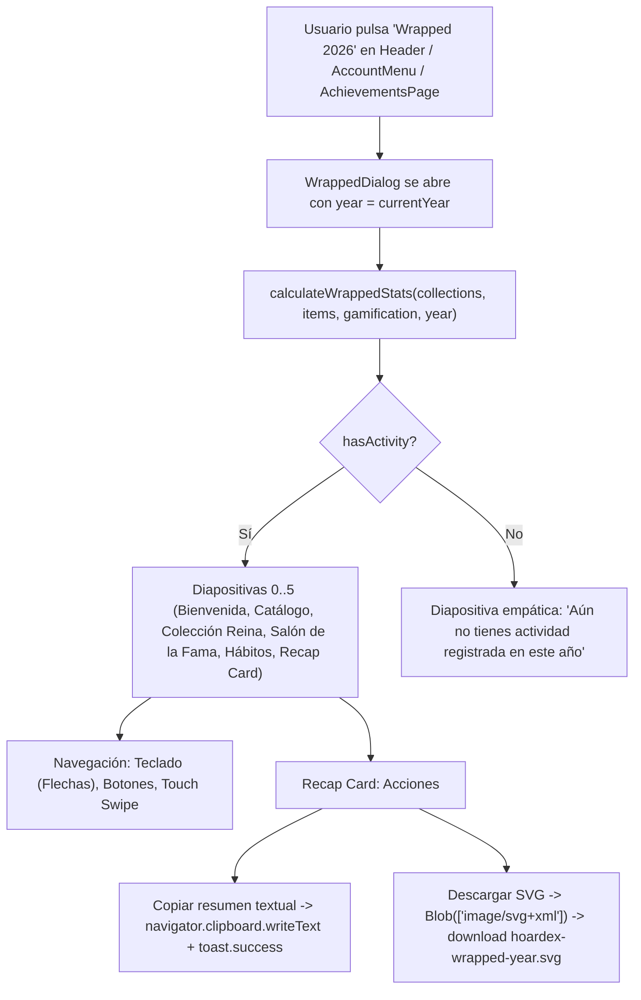

# Plan Técnico — Spec 007
**Fase 5: Hoardex Wrapped, Exportación CSV y Preparación para Despliegue en Vercel**

---

## 1. Archivos y responsabilidades

```text
src/
├── interfaces/
│   └── gamification.interface.ts         # Ampliación: Contratos WrappedStats, WrappedCollectionBreakdown, WrappedTopItem
├── features/
│   ├── gamification/
│   │   ├── core/
│   │   │   ├── wrapped.ts                # Motor analítico puro de cálculo de métricas anuales
│   │   │   ├── wrapped.test.ts           # Tests unitarios deterministas para wrapped.ts
│   │   │   ├── wrappedCard.ts            # Generador de texto social y renderizador SVG vectorial puro
│   │   │   └── wrappedCard.test.ts       # Tests unitarios para texto y generación SVG
│   │   └── components/
│   │       ├── WrappedDialog.tsx         # Modal interactivo accesible de diapositivas estilo Stories
│   │       └── WrappedDialog.test.tsx    # Tests de accesibilidad, teclado y navegación de diapositivas
│   └── sync/
│       ├── core/
│       │   ├── csv.ts                    # Serializador universal puro de catálogo a CSV (RFC 4180 + BOM)
│       │   └── csv.test.ts               # Tests unitarios de escapado y formateo CSV
│       └── components/
│           ├── AccountMenu.tsx           # Ampliación: Opción de exportar CSV y acceso a Wrapped
│           └── AccountMenu.test.tsx      # Tests de interacción ampliados
├── components/
│   └── custom/
│       ├── Header.tsx                    # Ampliación: Botón accesible de apertura de Wrapped
│       └── Header.test.tsx               # Tests de presencia y apertura del modal
├── pages/
│   └── AchievementsPage.tsx              # Ampliación: Banner / botón de acceso a Wrapped en la pestaña Stats
├── index.html                            # Metadatos SEO, Open Graph, Twitter Cards y favicon temático
├── .env.example                          # Plantilla documentada de variables de entorno (RAWG, Supabase)
└── vercel.json                           # Configuración de rewrite SPA para despliegue en Vercel
```

---

## 2. Contratos y funciones puras de lógica

### 2.1 Contratos en `src/interfaces/gamification.interface.ts`
```typescript
export interface WrappedCollectionBreakdown {
  collectionId: string;
  collectionName: string;
  accentColor: string;
  icon: string;
  itemsCount: number;
  percentage: number;
}

export interface WrappedTopItem {
  id: string;
  title: string;
  collectionName: string;
  rating: number;
  releaseYear?: number;
  coverUrl?: string;
}

export interface WrappedStats {
  year: number;
  hasActivity: boolean;
  totalAdded: number;
  totalCompleted: number;
  completionRate: number; // 0..100 redondeado a entero
  averageRating: number | null; // e.g. 4.5
  favoriteCollection: WrappedCollectionBreakdown | null;
  collectionsBreakdown: WrappedCollectionBreakdown[];
  topRatedItems: WrappedTopItem[];
  longestStreak: number;
  level: number;
  levelTitle: string;
  totalXp: number;
}
```

### 2.2 Motor analítico en `src/features/gamification/core/wrapped.ts`
```typescript
export function calculateWrappedStats(
  collections: Collection[],
  items: Item[],
  gamification: PersistedGamificationData | GamificationState,
  targetYear: number
): WrappedStats;
```
- **Filtro temporal:** Se evalúan los ítems creados en el año (`item.createdAt.startsWith(String(targetYear))`) o actualizados en el año (`(item.updatedAt ?? item.createdAt).startsWith(String(targetYear))`).
- **Completados:** Un ítem se considera completado en el año si su colección define un estado con `isCompleted: true`, el ítem tiene dicho `statusId` y su fecha de actualización corresponde al año.
- **Colección favorita:** Aquella con mayor suma de ítems agregados y completados en el año (desempate determinista por fecha de creación de la colección).
- **Pureza:** No invoca `new Date()` sin parámetro; recibe `targetYear` de forma explícita.

### 2.3 Generador de resumen social y tarjeta vectorial en `src/features/gamification/core/wrappedCard.ts`
```typescript
export function generateWrappedShareText(stats: WrappedStats): string;
export function generateWrappedSvg(stats: WrappedStats): string;
```
- `generateWrappedShareText`: Genera un texto conciso estructurado con emojis y saltos de línea optimizado para redes sociales.
- `generateWrappedSvg`: Genera una cadena XML SVG nativa con `viewBox="0 0 1080 1350"`, gradientes lineales con la identidad de marca de Hoardex (`#0f172a`, `#6366f1`, `#a855f7`), tarjetas visuales vectoriales con las estadísticas, tipografías estándar de sistema (`system-ui, -apple-system, sans-serif`) y el logotipo de Hoardex.

### 2.4 Serializador CSV en `src/features/sync/core/csv.ts`
```typescript
export function exportToCsv(collections: Collection[], items: Item[]): string;
export function escapeCsvValue(value: string | number | boolean | null | undefined): string;
```
- Aplica el estándar RFC 4180: cualquier valor con comas, saltos de línea o comillas dobles se envuelve en `"..."`, duplicando comillas internas (`""`).
- Agrega el prefijo UTF-8 Byte Order Mark (`\uFEFF`) para compatibilidad nativa en Microsoft Excel (Windows/macOS).

---

## 3. Algoritmo y flujo de datos



---

## 4. Integración de interfaz y accesibilidad

### 4.1 Componente `WrappedDialog.tsx`
- **Atributos de accesibilidad:** `role="dialog"`, `aria-modal="true"`, `aria-label="Hoardex Wrapped"`, captura de foco y cierre con `Escape`.
- **Navegación:**
  - `ArrowLeft` / `ArrowRight` para anterior / siguiente.
  - Indicadores superiores estilo "Stories" con 6 barras (`progress`) mostrando la diapositiva actual.
  - Soporte de gestos táctiles mediante eventos `onTouchStart` y `onTouchEnd` calculando el desplazamiento delta X para cambiar de diapositiva en pantallas táctiles móviles.
  - Selector de año conmutativo en la cabecera si hay ítems de años anteriores.
- **Soporte de animación reducida:** Clases condicionales de Tailwind respetando `motion-reduce:transition-none`.

### 4.2 Integración en la aplicación
- **`Header.tsx`:** Botón destacado con icono de destellos (`Sparkles`) y texto *"Wrapped 2026"* (visible junto al switch de tema y menú de cuenta).
- **`AccountMenu.tsx`:** Nueva opción con icono de destellos *"Ver Hoardex Wrapped"* y opción de descarga *"Exportar catálogo CSV"*.
- **`AchievementsPage.tsx`:** En la pestaña *"Estadísticas"*, botón o tarjeta destacada *"Revive tu año con Hoardex Wrapped"*.

---

## 5. Decisiones técnicas justificadas

1. **Diálogo modal inmersivo (`WrappedDialog.tsx`) frente a ruta `/stats` o `/wrapped`:**
   - *Decisión:* Implementar Wrapped como un diálogo modal accesible a pantalla completa.
   - *Justificación:* Mantiene al usuario en su contexto de navegación actual (p. ej. en la home, perfil o colección), se abre al instante sin recargas de ruta y permite integrarlo como llamada a la acción en múltiples puntos (`Header`, `AccountMenu`, `AchievementsPage`) sin añadir dependencias de rutas auxiliares.

2. **Generación vectorial SVG pura frente a `html2canvas` / `canvas`:**
   - *Decisión:* Construir la función pura `generateWrappedSvg` que serializa un documento SVG válido a partir de las métricas.
   - *Justificación:* Evita instalar librerías pesadas como `html2canvas` (~200KB), es 100% determinista, no sufre problemas de fuentes no cargadas ni desenfoques de densidad de píxeles, escala con nitidez vectorial a cualquier resolución (1080x1350) y se puede descargar como archivo `.svg` ligero al instante.

3. **Serializador CSV puro (RFC 4180 + BOM) frente a `papaparse`:**
   - *Decisión:* Función pura nativa de 30 líneas con manejo de comillas duplicadas y `\uFEFF`.
   - *Justificación:* Cero dependencias adicionales en `package.json`, cero `any` y total cumplimiento de los principios 1, 4 y 5 de la constitución.

4. **Rewrite en `vercel.json`:**
   - *Decisión:* Rewrite estándar `{ "source": "/(.*)", "destination": "/index.html" }`.
   - *Justificación:* Garantiza que las rutas del cliente (`/`, `/collections/:id`, `/achievements`) se sirvan limpiamente en producción en Vercel sin producir errores 404 al recargar.

---

## 6. Estrategia de tests

1. **`wrapped.test.ts`:**
   - Cálculo con catálogo vacío o año sin actividad (`hasActivity: false`, métricas en cero, sin divisiones por cero).
   - Cálculo con ítems de múltiples colecciones y años: verifica filtrado correcto por `targetYear`.
   - Cálculo de completados e ítems en curso.
   - Cálculo de valoración media con redondeo a 1 decimal y exclusión de ítems sin nota (`rating === null`).
   - Identificación de "Colección Reina" ante desempates deterministas.
   - Top 5 de mejores ítems ordenados descendentemente por puntuación.
   - Integración con racha (`longestStreak`) y nivel actual.

2. **`wrappedCard.test.ts`:**
   - Formateo del texto enriquecido para portapapeles con los datos calculados.
   - Generación del string XML SVG: comprueba estructura de etiquetas `<svg>`, `viewBox="0 0 1080 1350"`, inclusión de textos de métricas, colores de identidad y escapado seguro de caracteres XML.

3. **`csv.test.ts`:**
   - Generación de cabecera estándar con todas las columnas obligatorias.
   - Escapado estricto de textos con comas, comillas dobles internas y saltos de línea.
   - Presencia del prefijo BOM UTF-8 `\uFEFF`.
   - Mapeo fiel de estados completados (`is_completed: "true"` / `"false"`).

4. **`WrappedDialog.test.tsx`:**
   - Renderizado accesible (`role="dialog"`).
   - Navegación por diapositivas con teclado (`ArrowRight` avanza, `ArrowLeft` retrocede).
   - Cierre con tecla `Escape` o botón de cerrar.
   - Copiado en portapapeles al pulsar el botón de compartir.
   - Descarga del SVG al pulsar el botón correspondiente.

---

## 7. Trazabilidad de requisitos (Matriz de trazabilidad)

| Requisito Funcional | Archivo de Implementación | Prueba Unitaria |
|---|---|---|
| **RF-01.1 .. RF-01.8 (Cálculo analítico)** | `src/features/gamification/core/wrapped.ts` | `src/features/gamification/core/wrapped.test.ts` |
| **RF-02.1 .. RF-02.6 (Modal y diapositivas)** | `src/features/gamification/components/WrappedDialog.tsx` | `src/features/gamification/components/WrappedDialog.test.tsx` |
| **RF-03.1, RF-03.2 (Copiado de resumen)** | `src/features/gamification/core/wrappedCard.ts` | `src/features/gamification/core/wrappedCard.test.ts` |
| **RF-03.3 (Descarga de tarjeta SVG)** | `src/features/gamification/core/wrappedCard.ts` | `src/features/gamification/core/wrappedCard.test.ts` |
| **RF-04.1 .. RF-04.5 (Exportación CSV)** | `src/features/sync/core/csv.ts` | `src/features/sync/core/csv.test.ts` |
| **RF-05.1 (Vercel SPA Rewrites)** | `vercel.json` | Verificación de archivo estático |
| **RF-05.2 (SEO y Open Graph)** | `index.html` | Verificación estática de etiquetas meta |
| **RF-05.3 (Variables de entorno)** | `.env.example` | Verificación estática de variables documentadas |
| **RF-05.4 (Build de producción)** | `vite.config.ts` / `dist/` | `npm run build` |
