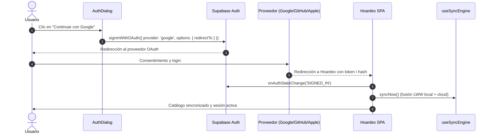

# Plan Técnico y de Arquitectura — Spec 008
**Autenticación OAuth (Google, Apple, GitHub), Perfiles de Usuario y Privacidad de Colecciones**

---

## 1. Archivos y Responsabilidades

### Contratos e Interfaces (`src/interfaces/`)
- **`src/interfaces/user.interface.ts` (Nuevo):**
  - Contrato del dominio `Profile` (`id`, `username`, `displayName`, `avatarUrl`, `bio`, `isPublic`, `createdAt`, `updatedAt`).
  - Contrato de base de datos `ProfileRow` (PostgREST row con tipos planos).
  - Parámetros de mutación `UpdateProfileParams` (`username?`, `displayName?`, `bio?`, `avatarUrl?`, `isPublic?`).
  - Modelo agregado `PublicProfileData` (`profile: Profile`, `collections: Collection[]`, `items: Item[]`, `gamification: PublicGamificationSummary`).
- **`src/interfaces/collection.interface.ts` (Modificado):**
  - Incorporar propiedad opcional `isPublic?: boolean` a `Collection`, `CreateCollectionParams` y `UpdateCollectionParams`.
- **`src/interfaces/sync.interface.ts` (Modificado):**
  - Añadir `is_public?: boolean` a `CollectionRow`.

### Esquema y Migración SQL (`supabase/`)
- **`supabase/schema.sql` (Modificado):**
  - Definición de tabla `public.profiles`.
  - Trigger y función `handle_new_user()` en PostgreSQL para auto-crear perfil con `@username` sanitizado y avatar desde metadatos OAuth.
  - Columna `is_public` en tabla `collections`.
  - Políticas de Row Level Security (RLS) actualizadas para `profiles`, `collections`, `items` y `gamification_state`.

### Dominio de Usuarios (`src/features/users/`)
- **`src/features/users/core/profiles.ts` & `profiles.test.ts` (Nuevos):**
  - Función pura `validateUsername(username: string)`.
  - Función pura `generateInitials(displayName: string, username?: string)`.
  - Mappers puros `mapProfileRowToProfile(row: ProfileRow)` y `mapProfileToRow(profile: Profile)`.
  - Función pura `filterPublicCollections(collections: Collection[])`.
- **`src/features/users/store/profile.store.ts` & `profile.store.test.ts` (Nuevos):**
  - Store Zustand para el perfil del usuario autenticado: `profile: Profile | null`, `isLoading: boolean`, acciones `setProfile`, `updateProfile` y `clearProfile`.
- **`src/features/users/hooks/useProfile.ts` & `useProfile.test.ts` (Nuevos):**
  - Hook para consultar y sincronizar el perfil del usuario activo contra Supabase cuando la sesión está autenticada.
- **`src/features/users/hooks/usePublicProfile.ts` & `usePublicProfile.test.ts` (Nuevos):**
  - Hook para consultar datos agregados de un perfil público por `username` (`profiles`, `collections`, `items`, `gamification_state`).
- **`src/features/users/components/UserAvatar.tsx` & `UserAvatar.test.tsx` (Nuevos):**
  - Componente accesible para renderizar avatar con imagen externa o fallback con iniciales y gradiente temático.
- **`src/features/users/components/ProfileSettingsDialog.tsx` & `ProfileSettingsDialog.test.tsx` (Nuevos):**
  - Diálogo modal accesible (`role="dialog"`) para editar `@username`, nombre, biografía, avatar URL y visibilidad global.

### Sincronización y Autenticación (`src/features/sync/`)
- **`src/features/sync/hooks/useAuth.ts` & `useAuth.test.ts` (Modificados):**
  - Exponer método `signInWithOAuth(provider: 'google' | 'apple' | 'github')`.
  - Escuchar eventos `SIGNED_IN` para cargar automáticamente el perfil y sincronizar con `useSyncEngine`.
- **`src/features/sync/components/AuthDialog.tsx` & `AuthDialog.test.tsx` (Modificados):**
  - Incorporar botones accesibles para Google, Apple y GitHub con iconos SVG oficiales y estados de carga.
- **`src/features/sync/components/AccountMenu.tsx` & `AccountMenu.test.tsx` (Modificados):**
  - Mostrar `@username` y avatar.
  - Añadir enlaces/acciones: *"Ver mi perfil público"* (`/u/:username`) y *"Editar perfil"* (abre `ProfileSettingsDialog`).

### Colecciones (`src/features/collections/`)
- **`src/features/collections/core/templates.ts` & `templates.test.ts` (Modificados):**
  - Mantener `isPublic: params.isPublic ?? true` en `createCollection`.
- **`src/features/collections/components/CollectionForm.tsx` & `CollectionForm.test.tsx` (Modificados):**
  - Añadir selector/interruptor accesible de visibilidad: Pública vs. Privada.
- **`src/features/collections/components/CollectionCard.tsx` (Modificado):**
  - Renderizar icono accesible de candado (`Lock`) cuando la colección sea privada (`isPublic === false`).

### Páginas y Rutas (`src/pages/` y `src/App.tsx`)
- **`src/pages/PublicProfilePage.tsx` & `PublicProfilePage.test.tsx` (Nuevos):**
  - Vista pública para la ruta `/u/:username`: cabecera de identidad, insignias de gamificación pública, colecciones públicas y logros. Estados de carga (*skeleton*), 404 (*Coleccionista no encontrado*) y perfil privado.
- **`src/App.tsx` (Modificado):**
  - Registrar la ruta dinámica `<Route path="/u/:username" element={<PublicProfilePage />} />`.

---

## 2. Funciones Puras de Lógica (`src/features/users/core/profiles.ts`)

```typescript
export interface UsernameValidationResult {
  isValid: boolean;
  error?: string;
}

/**
 * Valida de forma pura el formato de un @username.
 * Regla: 3 a 20 caracteres, únicamente minúsculas (a-z), números (0-9) y guiones bajos (_).
 */
export function validateUsername(username: string): UsernameValidationResult {
  if (!username || username.trim().length === 0) {
    return { isValid: false, error: 'El nombre de usuario no puede estar vacío.' };
  }
  const clean = username.trim();
  if (clean.length < 3) {
    return { isValid: false, error: 'El nombre de usuario debe tener al menos 3 caracteres.' };
  }
  if (clean.length > 20) {
    return { isValid: false, error: 'El nombre de usuario no puede exceder 20 caracteres.' };
  }
  const regex = /^[a-z0-9_]+$/;
  if (!regex.test(clean)) {
    return {
      isValid: false,
      error: 'Solo se permiten letras minúsculas (a-z), números (0-9) y guiones bajos (_).',
    };
  }
  return { isValid: true };
}

/**
 * Genera iniciales (1 o 2 letras) a partir de un nombre o username para el avatar fallback.
 */
export function generateInitials(displayName: string, username?: string): string {
  const source = displayName?.trim() || username?.trim() || '?';
  const parts = source.split(/\s+/).filter(Boolean);
  if (parts.length >= 2) {
    return (parts[0][0] + parts[1][0]).toUpperCase();
  }
  return source.slice(0, 2).toUpperCase();
}

/**
 * Mapea una fila PostgREST de profiles a la entidad Profile del dominio.
 */
export function mapProfileRowToProfile(row: ProfileRow): Profile {
  return {
    id: row.id,
    username: row.username,
    displayName: row.display_name,
    avatarUrl: row.avatar_url ?? null,
    bio: row.bio ?? null,
    isPublic: row.is_public ?? true,
    createdAt: row.created_at,
    updatedAt: row.updated_at,
  };
}

/**
 * Mapea la entidad Profile a la fila ProfileRow para inserción o actualización en Supabase.
 */
export function mapProfileToRow(profile: Partial<Profile> & { id: string }): Partial<ProfileRow> {
  const row: Partial<ProfileRow> = { id: profile.id };
  if (profile.username !== undefined) row.username = profile.username;
  if (profile.displayName !== undefined) row.display_name = profile.displayName;
  if (profile.avatarUrl !== undefined) row.avatar_url = profile.avatarUrl;
  if (profile.bio !== undefined) row.bio = profile.bio;
  if (profile.isPublic !== undefined) row.is_public = profile.isPublic;
  if (profile.updatedAt !== undefined) row.updated_at = profile.updatedAt;
  return row;
}

/**
 * Filtra puramente colecciones públicas.
 */
export function filterPublicCollections(collections: Collection[]): Collection[] {
  return collections.filter((c) => c.isPublic !== false);
}
```

---

## 3. Algoritmo y Flujo de Datos

### Flujo 1: Inicio de Sesión OAuth y Conciliación Automática


### Flujo 2: Creación Automática de Perfil en PostgreSQL (`handle_new_user`)
```sql
CREATE OR REPLACE FUNCTION public.handle_new_user()
RETURNS TRIGGER
LANGUAGE plpgsql
SECURITY DEFINER
SET search_path = public
AS $$
DECLARE
  base_username TEXT;
  final_username TEXT;
  full_name TEXT;
  avatar TEXT;
  suffix INT;
BEGIN
  -- Extraer nombre y avatar desde raw_user_meta_data
  full_name := COALESCE(
    NEW.raw_user_meta_data->>'full_name',
    NEW.raw_user_meta_data->>'name',
    split_part(NEW.email, '@', 1)
  );

  avatar := COALESCE(
    NEW.raw_user_meta_data->>'avatar_url',
    NEW.raw_user_meta_data->>'picture',
    NULL
  );

  -- Sanitizar nombre base para @username: minúsculas, solo [a-z0-9_], truncar a 14 chars
  base_username := lower(regexp_replace(split_part(NEW.email, '@', 1), '[^a-z0-9_]', '_', 'g'));
  IF char_length(base_username) < 3 THEN
    base_username := rpad(base_username, 3, '_');
  END IF;
  base_username := substring(base_username FROM 1 FOR 14);

  final_username := base_username;

  -- Resolver colisiones deterministas si el username ya existe
  WHILE EXISTS (SELECT 1 FROM public.profiles WHERE username = final_username) LOOP
    suffix := floor(random() * 9000 + 1000)::INT;
    final_username := substring(base_username FROM 1 FOR 14) || '_' || suffix;
  END LOOP;

  INSERT INTO public.profiles (id, username, display_name, avatar_url, is_public, created_at, updated_at)
  VALUES (NEW.id, final_username, full_name, avatar, true, now(), now())
  ON CONFLICT (id) DO NOTHING;

  RETURN NEW;
END;
$$;
```

### Flujo 3: Navegación y Lectura de Perfil Público (`/u/:username`)
```text
1. Usuario o visitante accede a /u/:username.
2. usePublicProfile(username) consulta:
   a) SELECT * FROM profiles WHERE username = :username LIMIT 1.
   b) Si no existe -> renderiza 404 ("Coleccionista no encontrado").
   c) Si exists pero is_public === false y auth.uid() !== profile.id -> renderiza vista ("Perfil privado").
   d) Si es público (o es el propietario):
      - SELECT * FROM collections WHERE user_id = profile.id AND is_public = true (o todas si es dueño).
      - SELECT * FROM items WHERE collection_id IN (public_collections_ids).
      - SELECT total_xp, streak, unlocked_achievements FROM gamification_state WHERE user_id = profile.id.
3. Se calcula el nivel y título derivado mediante calculateLevelProgress(totalXp).
4. Se renderiza la interfaz completa de estanterías y logros públicos.
```

---

## 4. Integración de Interfaz

1. **`AuthDialog.tsx`:**
   - Sección superior: Formulario clásico (correo y contraseña).
   - Separador *"o continuar con"*.
   - Fila de 3 botones con iconos SVG oficiales:
     - `GoogleButton`: Icono SVG tetracolor oficial de Google.
     - `AppleButton`: Icono SVG de la manzana de Apple.
     - `GitHubButton`: Icono SVG del octocat de GitHub.
   - Estado de carga en los botones durante la llamada a `signInWithOAuth`.

2. **`AccountMenu.tsx`:**
   - Cabecera: Avatar (`UserAvatar`), `displayName` y `@username`.
   - Elemento de menú: *"Ver mi perfil público"* con icono `ExternalLink`, navegando a `/u/${profile.username}`.
   - Elemento de menú: *"Editar perfil"* con icono `UserCog`, abriendo `ProfileSettingsDialog`.

3. **`ProfileSettingsDialog.tsx`:**
   - Diálogo modal accesible de Radix UI.
   - Previsualización en vivo del avatar con selector de URL externa opcional.
   - Campo `@username` con prefijo visual `@` y mensaje de advertencia sobre enlaces externos.
   - Campo `displayName` y `bio` (con contador dinámico de 280 caracteres).
   - Interruptor (*Switch*) para `isPublic` (Público vs. Privado).

4. **`CollectionForm.tsx`:**
   - Campo de visibilidad accesible con dos opciones tipo tarjeta o switch:
     - *"Pública"* (por defecto): Visible en tu perfil `/u/:username`.
     - *"Privada"*: Solo tú puedes ver esta colección y sus ítems.

5. **`PublicProfilePage.tsx`:**
   - Header heroico: Avatar grande, `@username`, nombre, biografía y botón *"Compartir perfil"* (`navigator.clipboard.writeText`).
   - Badges de gamificación: Nivel, título, XP total y racha récord.
   - Pestañas o cuadrícula: Colecciones públicas con conteo de ítems y colores de acento, notas y valoraciones de los ítems. Vitrina de medallas de logros desbloqueados.

---

## 5. Decisiones Técnicas Justificadas

1. **Identidad federada vía Supabase `signInWithOAuth` vs. SDKs directos de terceros:**
   - *Decisión:* Usar `supabase.auth.signInWithOAuth`.
   - *Alternativa descartada:* Cargar los SDKs pesados de Google (`gapi`), Apple JS o GitHub OAuth manual.
   - *Justificación:* Supabase abstrae los flujos de autorización, gestión de tokens JWT y refresh tokens de manera centralizada y segura sin engordar el bundle de la aplicación web.

2. **`isPublic` a nivel de `Collection` vs. duplicarlo en `Item`:**
   - *Decisión:* Almacenar `isPublic?: boolean` exclusivamente en `Collection`.
   - *Alternativa descartada:* Añadir `is_public` tanto a colecciones como a ítems.
   - *Justificación:* En un modelo relacional plano donde todo ítem pertenece a una colección (`collectionId`), la visibilidad del ítem deriva naturalmente de su colección. Esto evita inconsistencias de datos (ej. un ítem público en una colección privada) y simplifica las consultas RLS y el almacenamiento local.

3. **Generación automática de `@username` en trigger SQL vs. paso intermedio de onboarding en cliente:**
   - *Decisión:* Trigger PostgreSQL `handle_new_user` que crea el perfil al registrarse generando un `@username` inicial único.
   - *Alternativa descartada:* Bloquear la navegación tras OAuth obligando a rellenar un formulario de onboarding.
   - *Justificación:* Minimiza la fricción de entrada en OAuth (experiencia *"un clic"*). El usuario puede editar su `@username` cuando lo desee desde `ProfileSettingsDialog`.

4. **Avatares: Iniciales SVG / URLs externas vs. Bucket Storage en Fase 1 de identidad:**
   - *Decisión:* Soportar `avatarUrl` de OAuth y URLs externas HTTP(S), con generador puramente en cliente de iniciales.
   - *Alternativa descartada:* Configurar almacenamiento de blobs S3/Supabase Storage con subida de imágenes en esta tarea.
   - *Justificación:* Mantiene la arquitectura ligera y sin costes añadidos de almacenamiento ni endpoints de subida binaria multipart en esta fase, resolviendo el 100% de los casos de uso sociales iniciales.

---

## 6. Estrategia de Tests

- **`profiles.test.ts` (Lógica Pura):**
  - Validación de usernames válidos (`javi`, `gamer_2026`, `alex_99`).
  - Rechazo de usernames cortos (< 3 caracteres) o largos (> 20 caracteres).
  - Rechazo de caracteres no permitidos (mayúsculas, espacios, tildes, símbolos especiales).
  - Generación de iniciales con nombres simples, nombres compuestos y usernames.
  - Mappers `mapProfileRowToProfile` y `mapProfileToRow` con campos nulos y poblados.
  - Filtrado puro de colecciones públicas (`filterPublicCollections`).
- **`profile.store.test.ts` (Store Zustand):**
  - Acciones `setProfile`, `updateProfile` (inmutabilidad y actualización parcial) y `clearProfile`.
- **`AuthDialog.test.tsx` (Componente):**
  - Renderizado de los 3 botones OAuth (Google, Apple, GitHub).
  - Clic en cada botón invoca `signInWithOAuth` con el proveedor correcto.
- **`ProfileSettingsDialog.test.tsx` (Componente):**
  - Validación en vivo del campo `@username`.
  - Envío y mutación del perfil.
  - Aviso de advertencia sobre enlaces externos.
- **`CollectionForm.test.tsx` (Componente):**
  - Selección del switch de privacidad (`isPublic`).
- **`PublicProfilePage.test.tsx` (Página):**
  - Renderizado del estado de carga (*skeleton*).
  - Renderizado del estado 404 cuando el usuario no existe.
  - Renderizado del estado de perfil privado.
  - Renderizado completo del perfil público con estanterías y logros.
  - Comprobación de que las colecciones privadas nunca se muestran.

---

## 7. Trazabilidad de Requisitos

| Requisito Funcional | Archivos Implicados | Funciones / Componentes | Pruebas Asociadas |
|---|---|---|---|
| **RF-01** (OAuth Multi-proveedor) | `src/features/sync/hooks/useAuth.ts`, `AuthDialog.tsx` | `signInWithOAuth`, `AuthDialog` | `useAuth.test.ts`, `AuthDialog.test.tsx` |
| **RF-02** (Esquema SQL & RLS) | `supabase/schema.sql`, `src/interfaces/user.interface.ts` | `profiles`, `handle_new_user`, RLS policies | Verificación en Supabase / Tipado tsc |
| **RF-03** (Gestión de Perfil) | `ProfileSettingsDialog.tsx`, `profiles.ts`, `profile.store.ts` | `validateUsername`, `ProfileSettingsDialog` | `profiles.test.ts`, `ProfileSettingsDialog.test.tsx` |
| **RF-04** (Privacidad en Colecciones) | `CollectionForm.tsx`, `CollectionCard.tsx`, `templates.ts` | Selector `isPublic`, badge `Lock` | `CollectionForm.test.tsx`, `templates.test.ts` |
| **RF-05** (Página Pública `/u/:username`) | `PublicProfilePage.tsx`, `usePublicProfile.ts`, `App.tsx` | `PublicProfilePage`, `usePublicProfile` | `PublicProfilePage.test.tsx`, `usePublicProfile.test.ts` |
